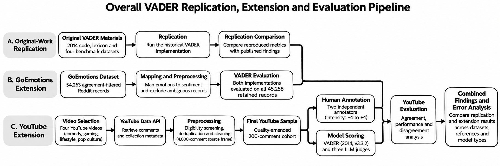

# COMP8240 VADER Replication

This project reproduces VADER on the original benchmarks and evaluates the adapted 2014 implementation and `vaderSentiment==3.3.2` on GoEmotions. It also contains the code used for the YouTube human-annotation and saved LLM-judge evaluation.

## Run the public workflow

Use Python 3.14 or later.

```sh
git clone https://github.com/manhtuannguyen-cmyk/comp8240-vader-replication.git
cd comp8240-vader-replication
python3 -m venv .venv
source .venv/bin/activate
python -m pip install -r requirements.txt
python src/data_processing/fetch_public_data.py --dataset original_vader
python src/evaluation/run_all_metrics.py --public-only
```

On Windows, activate the environment with `.venv\\Scripts\\activate`.

The public run writes reproducible results to `reports/replication/`, `reports/goemotions/`, and `reports/public/`.

## Pipeline



## Ethical data handling

Raw YouTube comments, comment and video identifiers, timestamps, annotator-level files, and saved item-level LLM outputs are access-restricted and are not published in this repository. They are required only for the private YouTube stream of the study.

The public repository retains the reproducible code, configuration, aggregate metrics, de-identified summary metadata, and figures. These materials support review of the methodology and results without republishing searchable comment text or identifiers. The public runner therefore skips the private YouTube stream rather than replacing it with new live API data or synthetic records.

## Main folders

- `src/` — processing, replication, annotation, LLM-judge, and evaluation code.
- `config/` — dataset mapping and source configuration.
- `data/` — public VADER and GoEmotions inputs plus de-identified YouTube metadata.
- `prompts/` — LLM-judge prompt input.
- `reports/` — aggregate evaluation results and figures.
